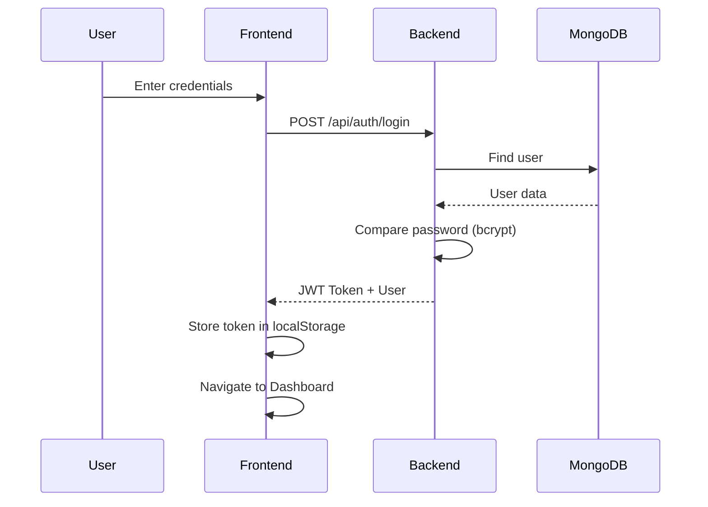
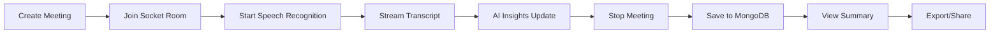

<div align="center">
  
  
  
  
  
  
</div>

<br />

<div align="center">
  
  
</div>

<br />

# Real-Time AI Meeting Assistant 🎯

<div align="center">
  
  
  
  
</div>

<div align="center">
  
  
  
</div>

<br />

A **production-ready, portfolio-grade** meeting transcription and AI-powered insights platform with real-time speech recognition, live dashboard, analytics, and professional authentication system.

## 🎬 Demo

> **Live Demo**: [Add your deployed link here]
> 
> **Demo Video**: [Add your demo video/GIF here]


## ✨ Key Features

### 🎙️ Core Functionality
| Feature | Description | Tech |
|---------|-------------|------|
| **Live Speech Transcription** | Real-time speech recognition using Web Speech API | Web Speech API |
| **AI-Powered Analysis** | Groq LLM extracts key points, action items, and decisions | Groq SDK |
| **Real-Time Dashboard** | Live transcript and insights with streaming updates | Socket.io |
| **Meeting Summaries** | Post-meeting recap with copy & PDF export | React + Print API |
| **Meeting Persistence** | MongoDB storage with full metadata | MongoDB + Mongoose |

### 🔐 Authentication & Security
| Feature | Description |
|---------|-------------|
| **User Registration** | Secure account creation with email/password |
| **JWT Authentication** | Token-based session management |
| **Password Hashing** | bcryptjs encryption for security |
| **Protected Routes** | All authenticated endpoints secured |
| **Session Management** | Token persistence across sessions |

### 📊 Analytics & Insights
| Feature | Description |
|---------|-------------|
| **Meeting Statistics** | Total meetings, words, minutes, avg duration |
| **Interactive Charts** | Bar, doughnut, and line charts using Chart.js |
| **Recent Activity** | Quick access to past sessions |
| **Google Calendar** | One-click calendar integration |
| **Export Options** | Copy, share via email, PDF export |

### 🎨 Modern UI/UX
| Feature | Description |
|---------|-------------|
| **Professional Dark Theme** | Optimized for readability |
| **Vibrant Gradients** | Brand (violet), accent (pink), success (green) |
| **Smooth Animations** | Framer Motion transitions throughout |
| **Real-Time Status** | Connection indicators and meeting timer |
| **Responsive Design** | Works on desktop, tablet, and mobile |
| **Toast Notifications** | react-hot-toast for user feedback |
| **Error Boundaries** | Graceful error handling |
| **Loading Skeletons** | Professional loading states |

## 🛠️ Tech Stack

### Frontend
```javascript
{
  "framework": "React 18.3.1",
  "build": "Vite 5.4.10",
  "styling": "Tailwind CSS 3.4.15",
  "animations": "Framer Motion 11.11.9",
  "state": "Zustand 4.5.0",
  "routing": "React Router DOM 6.x",
  "realtime": "Socket.io Client 4.1.0",
  "charts": "Chart.js + React-Chartjs-2",
  "notifications": "React Hot Toast",
  "speech": "Web Speech API"
}
```

### Backend
```javascript
{
  "runtime": "Node.js 22.x",
  "framework": "Express 4.21.0",
  "realtime": "Socket.io Server 4.1.0",
  "database": "MongoDB + Mongoose 8.17.0",
  "ai": "Groq SDK 0.12.0",
  "auth": "JWT + bcryptjs",
  "email": "Nodemailer"
}
```

## 📁 Project Structure

```
Real-Time AI Meeting Assistant/
├── frontend/
│   ├── src/
│   │   ├── pages/
│   │   │   ├── Login.jsx          # Authentication with split-screen design
│   │   │   ├── Register.jsx       # Account creation with features
│   │   │   ├── Dashboard.jsx      # Stats, search, meeting list
│   │   │   ├── LiveMeeting.jsx    # Real-time transcription + insights
│   │   │   ├── Summary.jsx        # Post-meeting recap with export
│   │   │   ├── MeetingDetail.jsx  # Individual meeting view
│   │   │   ├── Profile.jsx        # User settings
│   │   │   └── Analytics.jsx      # Charts and statistics
│   │   ├── components/
│   │   │   ├── TopBar.jsx         # Navigation + controls
│   │   │   ├── TranscriptPanel.jsx
│   │   │   ├── InsightsPanel.jsx
│   │   │   ├── MeetingTemplates.jsx
│   │   │   ├── OnboardingTour.jsx
│   │   │   ├── ErrorBoundary.jsx
│   │   │   ├── LoadingSpinner.jsx
│   │   │   └── Skeletons.jsx
│   │   ├── hooks/
│   │   │   ├── useSpeechRecognition.js
│   │   │   ├── useSocket.js
│   │   │   └── useKeyboardShortcuts.js
│   │   ├── context/
│   │   │   └── AuthContext.jsx
│   │   ├── store/
│   │   │   └── useMeetingStore.js
│   │   └── App.jsx
│   ├── public/
│   │   └── manifest.json
│   ├── index.html
│   ├── tailwind.config.js
│   └── package.json
├── backend/
│   ├── models/
│   │   ├── User.js
│   │   └── Meeting.js
│   ├── routes/
│   │   ├── auth.js
│   │   └── meetings.js
│   ├── socket/
│   │   └── meetingSocket.js
│   ├── services/
│   │   ├── groqService.js
│   │   ├── transcriptProcessor.js
│   │   └── emailService.js
│   ├── middleware/
│   │   └── auth.js
│   ├── server.js
│   ├── Dockerfile
│   └── .env.example
├── docker-compose.yml
├── .gitignore
└── README.md
```

## 🚀 Getting Started

### Prerequisites
- Node.js 18+
- MongoDB (local or Atlas)
- Groq API key ([Get one here](https://groq.com))
- Chrome/Edge (for Web Speech API)

### Installation

```bash
# Backend
cd backend
npm install

# Frontend
cd frontend
npm install
```

### Environment Setup

**backend/.env**
```env
PORT=4000
MONGODB_URI=mongodb://localhost:27017/meeting-assistant
GROQ_API_KEY=your_groq_api_key
JWT_SECRET=your_jwt_secret_key_here
SMTP_HOST=smtp.gmail.com
SMTP_PORT=587
SMTP_USER=your_email@gmail.com
SMTP_PASS=your_app_password
```

**frontend/.env**
```env
VITE_API_URL=http://localhost:4000
VITE_SOCKET_URL=http://localhost:4000
```

### Running

```bash
# Terminal 1 - Backend
cd backend
node server.js
# → http://localhost:4000

# Terminal 2 - Frontend
cd frontend
npm run dev
# → http://localhost:5173
```

### Docker (Production)

```bash
docker-compose up --build
```

## 🔐 Authentication Flow



## 🎯 Meeting Lifecycle



## 📊 Analytics Dashboard

The Analytics page includes **interactive charts** powered by Chart.js:

- **Bar Chart**: Word count per meeting
- **Doughnut Chart**: Meeting status distribution  
- **Line Chart**: Duration trends over time
- **Recent Activity**: Quick access with calendar integration

## 🎨 UI Features

<div align="center">
  
  
  
  
</div>

## 🧪 Testing

### Manual Test Checklist
- [x] Register new account
- [x] Login with credentials
- [x] View dashboard statistics
- [x] Start new meeting with template
- [x] Record and transcribe speech
- [x] View live AI insights
- [x] Stop meeting and save
- [x] View summary with export
- [x] Share via email
- [x] Analytics charts render
- [x] Profile settings
- [x] Logout

### Browser Support
- ✅ Chrome 90+ (recommended)
- ✅ Edge 90+
- ⚠️ Firefox 88+ (limited Web Speech)
- ⚠️ Safari 14+ (limited Web Speech)

## 📦 Deployment

### Frontend (Vercel/Netlify)
```bash
npm run build
# Deploy dist/ folder
```

### Backend (Render/Railway)
```bash
# Use Dockerfile or npm start
# Set environment variables
# Connect to MongoDB Atlas
```

### Environment Variables
| Variable | Description |
|----------|-------------|
| `PORT` | Backend port (default: 4000) |
| `MONGODB_URI` | MongoDB connection string |
| `GROQ_API_KEY` | Groq LLM API key |
| `JWT_SECRET` | JWT signing secret |
| `SMTP_HOST` | Email host (optional) |
| `SMTP_USER` | Email username (optional) |
| `SMTP_PASS` | Email password (optional) |

## 🎯 Portfolio Highlights

### Why This Project Stands Out

1. **Full-Stack Expertise**: React + Node + MongoDB + Socket.io
2. **Real-Time Systems**: Live transcription, insights, and sync
3. **AI Integration**: Groq LLM for intelligent summarization
4. **Production Quality**: Error boundaries, skeletons, Docker, env config
5. **Modern UI**: Glassmorphism, animations, responsive design
6. **Complete Auth**: JWT, bcrypt, protected routes
7. **Data Visualization**: Chart.js analytics with multiple chart types
8. **Deployment Ready**: Docker, docker-compose, env templates

### Key Technical Decisions

- **Zustand** over Redux for minimal boilerplate
- **Socket.io** for real-time bidirectional communication
- **Chart.js** for lightweight, responsive analytics
- **Framer Motion** for smooth, production-grade animations
- **Tailwind CSS** for consistent, maintainable styling
- **MongoDB** for flexible document storage

## 📈 Future Enhancements

- [ ] Real-time waveform visualization
- [ ] Speaker identification/diarization
- [ ] Multi-language transcription
- [ ] Team collaboration features
- [ ] Advanced search with filters
- [ ] Sentiment analysis
- [ ] Mobile app (React Native)
- [ ] Video recording integration
- [ ] Calendar sync (Google/Outlook)
- [ ] Custom meeting templates

## 🤝 Contributing

1. Fork the repository
2. Create feature branch (`git checkout -b feature/amazing-feature`)
3. Commit changes (`git commit -m 'Add amazing feature'`)
4. Push to branch (`git push origin feature/amazing-feature`)
5. Open Pull Request

## 📝 License

MIT License - Open source and free to use

## 🙏 Acknowledgments

- [Groq](https://groq.com) for LLM API
- [Tailwind CSS](https://tailwindcss.com) for styling
- [Framer Motion](https://framer.com/motion) for animations
- [Socket.io](https://socket.io) for real-time communication
- [MongoDB](https://mongodb.com) for data storage
- [Chart.js](https://chart.js) for analytics

---

<div align="center">
  <p>Built with ❤️ for developers who value clean code and great UX</p>
  <p>
    <a href="[your-portfolio-link]">Portfolio</a> •
    <a href="[your-demo-link]">Live Demo</a> •
    <a href="[your-github-link]">GitHub</a>
  </p>
</div>
